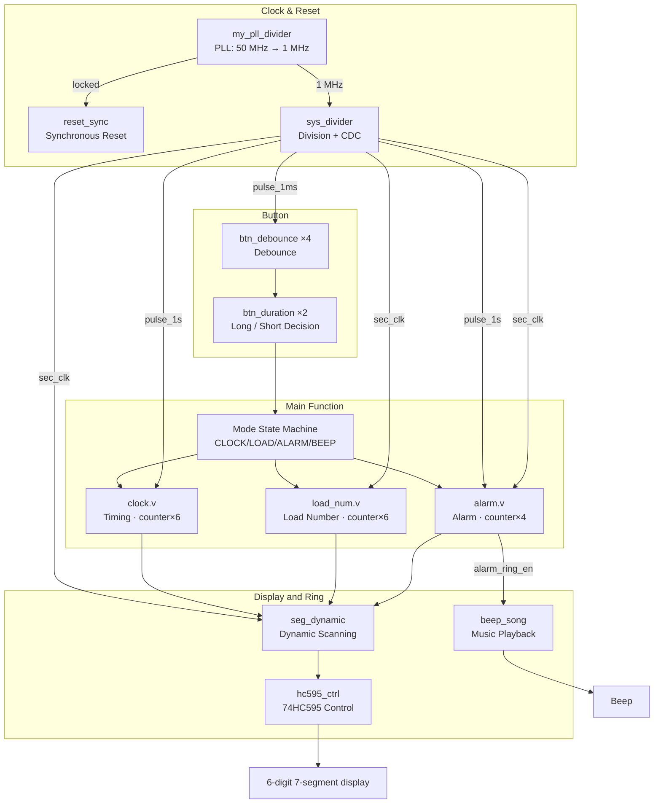

# FPGA-Based Multi-function Digital Clock

[简体中文](README.md)

> This project implements a multi-function digital clock on FPGA based on Verilog HDL. It displays the current time on a 6-digit 7-segment display and supports time-setting (load number), alarm, and other interactive functions.

**考虑是否添加个人情况说明：本项目属于自学verilog后的阶段性检测，很多设计在实际工程中可能并不适用**
## Catalog
- [FPGA-Based Multi-function Digital Clock](#fpga-based-multi-function-digital-clock)
  - [Catalog](#catalog)
  - [Environment](#environment)
  - [Attention](#attention)
    - [1. PLL - my\_pll\_divider (50 MHz → 1 MHz)](#1-pll---my_pll_divider-50-mhz--1-mhz)
    - [2. RAM - my\_ram (256 \* 12 bit read only music score)](#2-ram---my_ram-256--12-bit-read-only-music-score)
    - [3. Link music score file .mif](#3-link-music-score-file-mif)
    - [4. Others](#4-others)
  - [Main Functions](#main-functions)
  - [Features](#features)
  - [Framework](#framework)
  - [Key Mapping](#key-mapping)
  - [Notes](#notes)

## Environment

- EDA: Quartus II
- Hardware: Cyclone IV EP4CE10F17C8N on Wildfire Journey Pro development board
- On-board clock: 50 MHz crystal oscillator
- Peripherals: 6-digit 7-segment display (with decimal points) motivated by 74HC595, 4 keys (choose / number up / number down / load), one reset key

## Attention

This project is **not a pure RTL project** : In clock_mode.v a PLL IP-core was instantiated as my_pll_divider and in beep_song.v a RAM IP-core was instantiated as my_ram. I do not commit the IP-core files to the repository because they are generated by Quartus II wizard and are tied to a specific device. So you need to configure them in your own EDA. 

**The way to rebuild the two IP-core:** Use the parameters below to generate the two IP-cores with your own EDA tool. Name them as `my_pll_divider` / `my_ram` and ensure the port names in your IP-core file are the same as that in `clock_mode.v` (which instantiates the PLL) / `beep_song.v` (which instantiates the RAM). 

**For the settings I didn't mention below, please keep them default**

### 1. PLL - my_pll_divider (50 MHz → 1 MHz)

| Setting | Value | Note |
| --- | --- | --- |
| IP type | ALTPLL | - |
| Currently selected device family | Cyclone IV E (EP4CE10F17C8N) | Choose your own chip's name |
| Frequency of the inclk0 input | 50 MHz (i.e. 20000 ps) | Choose your own chip's parameter |
| Output clock c0 | clock multiplication factor ×1, clock division factor ÷50 → **1 MHz** | Choose your own chip's parameters |
| c0 duty cycle | 50% | - |
| c0 clock phase shift | 0° | - |
| Compensate Clock | CLK0 | Choose your own chip's parameter |

The port names are as follows (instantiated in `clock_mode.v`): 

| Port | Direction | Connection | Explanation |
| --- | --- | --- | --- |
| `areset` | input | `1'b0` | Reset (active high). PLL is automatically reset only at power-on; it is not controlled by the system reset signal `rst_n`. |
| `inclk0` | input | `sys_clk`| 50 MHz crystal oscillator |
| `c0` | output | `sys_clk_1mhz` | 1 MHz output as pre_clk domain for the system |
| `locked` | output | `locked_sig` | The lock flag controls the release of the global reset; the system stays in reset while the PLL is not locked. |

### 2. RAM - my_ram (256 * 12 bit read only music score)

| Setting | Value | Note |
| --- | --- | --- |
| IP type | RAM: 1-PORT (ALTSYNCRAM) | - |
| Currently selected device family | Cyclone IV E (EP4CE10F17C8N) | Choose your own chip's name |
| width of the output bus | 12 bit | - |
| width of the address | 8 bit (depth 256 i.e. 256 words) | - |
| Operation Mode | Single-Port | - |
| Read/Write Mode (Read During Write) | Read Priority (Read During Write: Old Data): Read-only through linking wren with 1'b0 | Different IP-cores have different port names |
| Output register | Registered output on the rising edge of clock | - |

The port names are as follows (instantiated in `beep_song.v`): 

| Port | Direction | Connection | Explanation |
| --- | --- | --- | --- |
| `address[7:0]` | input | `rd_addr` | Music score address pointer |
| `clock` | input | `sys_clk` | system clock |
| `data[11:0]` | input | `12'd0` | Read-only; write port is unused |
| `wren` | input | `1'b0` | Read-only; write enable port disabled |
| `q[11:0]` | output | `rd_data` | Music score code read from RAM |

The format of music score code is shown below. It is decoded by `beep_song.v`. Each musical note occupies 12 bits = `{octave[3:0], note name[3:0], duration[3:0]}`. 

| Bit  | Value |
| --- | --- |
| Octave | 3/4/5 = Oct3/4/5, 0 = rest note, F = end marker |
| Note name | 1~7 = DO/RE/ME/FA/SO/LA/XI, 8~C = Sharp (DO♯/RE♯/FA♯ etc.), 0 = rest note, F = end marker |
| duration | 1 = sixteenth note, 2 = eighth note, 3 = Dotted eighth note, 4 = Quarter note, 6 = Dotted quarter note, 8 = Half note, F = Whole note |

Note: 
- The end marker should be: bit[11:4]=FF, bit[3:0] are don't-care bits, but still must be written. 
  - The end marker equal to the Final Bar Line :||. When FPGA sample FF in the high 8 bits of the music score code, it would not read the low 4 bis. So the low 4 bits can be anything except empty. If the low 4 bits are empty, the EDA synthesizes the high 8 bits as low 8 bit and adds zero to the high 4 bits to make sure 12 bits width the music core code is legal, which cause mistakes. 

### 3. Link music score file .mif

The music score code is stored in `beep/`. There are two songs: 
- `your_new_home.mif` - _Your New Home_, the theme song of _The Amazing Digital Circus_. The default song. 
- `qifengle.mif` - _Qi Feng Le_

在配置页面把初始化文件指向其中之一。
**Attention: init_file path is 相对 the catalog of the main project `.qpf` file, not 相对 RAM file**. ~~For instance, if the project is under the `quartus_prj/`, the path should be `../rtl/beep/your_new_home.mif`. ~~

Change the song: 
1. Change the init_file path to another `.mif` 
2. Change the BPM parameter to the matching value in beep_song.v. ( _Qi Feng Le_ BPM is 80, _Your New Home_ is 59, a little bit faster ). After that synthesize the whole project. If the RAM is not connected `.mif` (or the path is wrong), it will be empty. So the beep won't ring. 

### 4. Others

- The system clock is set as **50 MHz**: The tone and BPM in the `beep_song.v`, the division parameters in the `sys_divider.v` are designed according to 50 MHz. If your frequency of crystal oscillator (system clock) is not the same as mine, please change these parameters. 
- The files of the two IP-cores above belong to my chip. **Other chips cannot use them directly.** So I do not let them open-sourced. Users need to use their EDA to generate the codes and rename the instantiation in the `clock_mode.v` & `beep_song.v`. 
- The 按键引脚绑定 is shown in the Key Mapping table. The pins of `hc595_ctrl` ( `stcp` / `shcp` / `ds` / `oe` ) and `beep` should be assigned in accordance with your own development board. 

## Main Functions

- ✅Clock: Shows hour, minute and second. The decimal points twinkle at 1 Hz. 
- ✅Load number: Short press load key to switch to this mode. The display shows `LOAd` for 1 second first as a prompt. And then, users can set the time in the edit page and long press load key to confirm the setting. If users don't press any button for 15 seconds, the system will switch back to clock automatically. 
	- Actually, the duration is not 15 seconds. Firstly, the illustration `LOAd` takes (0.5,1] seconds. Secondly, the moment of counters' update, driven by pulse_1s, is offset from the moment when users press the button by [0,1) seconds. As a result, the time in the edit page is 13~14.5 seconds, after which the mode will change back to clock. 
- ✅Alarm: 4 alarm(the number can be changed), can be enable/disable. Users can set the hour and minute, while the second is zero fixedly.  
- ✅Beep ring: After the alarm is triggered, the passive buzzer plays _Qi Feng Le_ or _Your New Home_. The song lasts for 59 seconds. If users want to stop, press the choose, num_up or num_down. 
- ✅Beep display: If current mode is clock, after the alarm is triggered, the display switches to beep display, which shows the time of alarm and twinkles slowly at 0.5 Hz. 

## Features

- **One module is instantiated in three modules**: `counter.v` is a universal counter. The radix is decided by the port `radix_data`. This module is instantiated in `clock.v` `load_num.v` `alarm.v` for 16 times. Every digit connects with a counter, which means we do not need a binary system changing to BCD module. 
- **Variable-radix**: Since every digit connects to its unique counter, its radix is independent. So this project faces the hour units digit variable-radix problem: when the hour tens digit is 0/1, the radix of hour units is decimal, but when the hour tens digit is 2, the radix of hour units is radix 4. Let me take the showing time & loading number functions in `clock.v` module as an example: When showing the time, the radix of hour units digit `radix_hour` is decided by the output of hour tens digit counter out_hour[7:4], while loading number, the radix is decided by the hour tens digit data_hour[7:4] loaded to the clock. 
  - The similar solutions are also used in the `load_num.v` and `alarm.v` module, which is the hardest problem in the whole project. 
- **Clock Domain Crossing**: The PLL output 1 MHz clock (pre_clk domain) and system 50 MHz clock (sys_clk domain) are two clock domains in this project, causing the CDC violation. To avoid metastability, I choose toggle-flag + three registers + 边沿检测. 
- **State Machine**: The state machines are widely used in this project, including three-stage state machines in `clock_mode.v` `btn_duration.v` and three state machines cooperating together in `load_num.v` `alarm.v`. 
- **Parameterized Width**: Use `$clog2` to compute the bit width of the counter. The debounce period `DEBOUNCE_MS`, long & short pressing threshold `SHORT_END_MS` `LONG_PRESS_MS`, the binary input width `BIN_WIDTH` of bit to BCD module are all parameterized the same way. 

## Framework

## Key Mapping

| Key | Function | Key Mapping | Button |
|------|------|------|------|
| choose | Load_num mode: switch the setting field (hour → minute → second → hour)   Alarm view mode: switch the alarm number   Alarm edit mode: switch the setting field (state → hour → second → state)   Alarm editing entrance: long press three seconds   Alarm ring: press this button can disrupt the ring | M2 | KEY1 |
| num_down | Number -1   Alarm ring: press this button can disrupt the ring | M1 | KEY2 |
| num_up | Number +1   Alarm ring: press this button can disrupt the ring | E15 | KEY3 |
| load | Clock mode: short press to enter load_num mode   Load_num mode: short press to enter alarm mode, long press 3 seconds to confirm the loading number   Alarm view mode: short press back to clock mode   Alarm edit mode: short press to cancel, long press for three seconds to confirm the alarm number   Alarm ring: attention, press load button can not disrupt the ring. In the future, it can be use for snooze function: pressing load button can stop the ring, while pressing other button makes the alarm snooze for ten minutes. | E16 | KEY4 |
| reset | reset | M15 | RESET |

## Notes

- In all twinkle displays, the twinkle of number and point is opposite, i.e. when the numbers are lit the points are dark, when the points are lit the numbers are dark. 
- Parameter instruction: Some counter widths are computed automatically via \$clog2(N). The parameter N should not be less than 2. 
- The hour bits Variable-radix design easily has some bugs. Pay attention to the time when the radix changes: Take the clock function as an example: When the hour is 20~23, edit the loading number to 04~09 or 14~19. After confirming the loading number, check whether the clock will be 03 or 13, which is a typical bug. The check is similar in load_num. For alarm function, except the check for clock & load_num, the switch from default -- to normal counter should also be checked. 
  - It is hard to explain without codes. I wrote detailed notes in the codes of `clock.v` `load_num.v` `alarm.v`. 
- The signal alarm_ring_en generated from `alarm.v` maintains high level for 1 second and is sampled by `clock_mode.v` to trigger the counter_beep increment. Before counter_beep reaches 59, beep_en stays high and is fed to the `beep_song.v` module. 
- The data flow for the beep display: `alarm.v` records the alarm number by beep_idx and sets the alarm_ring_en to high level. Sampling the alarm_ring_en signal, `clock_mode.v` sets alarm_beep_disp_en to high level, which is sampled by `alarm.v`. The `alarm.v` outputs the twinkle time of the alarm whose number is beep_idx to disp_* ports to `clock_mode.v`. Finally, the `seg_dynamic.v` samples the disp_* and show the time of alarm. 
- The  `btn_duration.v` module is in charge of deciding the long/short-press of button. If the duration of pressing is less than 500 ms, it is a short press. If the duration of pressing is more than 3 s, it is a long press. If the duration is between 50 0ms and 3 s, it is invalid. Since all buttons are debounced at first, the actual long/short-press thresholds should each be extended by the 20 ms debounce time. 
