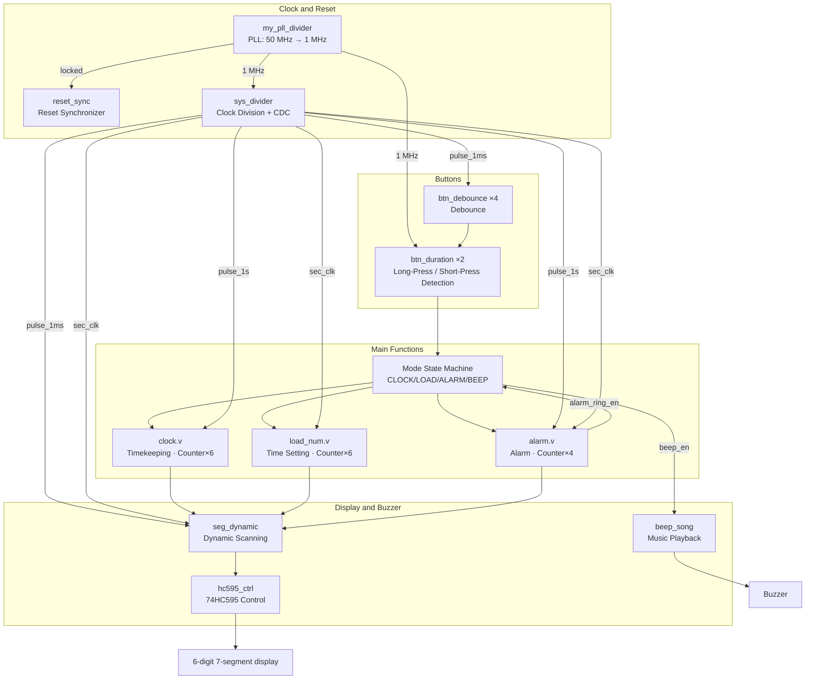

# FPGA-Based Multifunction Digital Clock

[简体中文](README.md)

> A multifunction digital clock written in Verilog HDL for an FPGA. It shows the time on a 6-digit 7-segment display and supports timekeeping, time setting and alarms.

<!-- TODO: **考虑是否添加个人情况说明：本项目属于自学verilog后的阶段性检测，很多设计在实际工程中可能并不适用**-->

## Contents
- [FPGA-Based Multifunction Digital Clock](#fpga-based-multifunction-digital-clock)
  - [Contents](#contents)
  - [Development Environment](#development-environment)
  - [Before You Start](#before-you-start)
    - [1. PLL - my\_pll\_divider (50 MHz → 1 MHz)](#1-pll---my_pll_divider-50-mhz--1-mhz)
    - [2. RAM - my\_ram (256 × 12-bit read-only music score)](#2-ram---my_ram-256--12-bit-read-only-music-score)
    - [3. Link music score file .mif](#3-link-music-score-file-mif)
    - [4. Others](#4-others)
  - [Main Functions](#main-functions)
  - [Features](#features)
  - [Design Overview](#design-overview)
  - [Key Mapping](#key-mapping)
  - [Notes](#notes)

## Development Environment

- EDA tool: Quartus II 13.0
- Hardware: Cyclone IV EP4CE10F17C8N on an EmbedFire Journey Pro development board
- On-board clock: 50 MHz crystal oscillator
- Peripherals: 6-digit 7-segment display (with decimal points) driven by two cascaded 74HC595 shift registers, four push buttons (`choose` / `num_up` / `num_down` / `load`), one reset button

## Before You Start

This project is **not a pure-RTL project**: `clock_mode.v` instantiates a PLL IP core (`my_pll_divider.v`) and `beep_song.v` instantiates a RAM IP core (`my_ram.v`). Both are generated by the Quartus II MegaWizard and tied to a specific device. So their generated files are not in this repository, and the project will not compile until you regenerate them with your own EDA tool. 

**How to rebuild the two IP cores:** Use the parameters below to generate the two IP cores with your own EDA tool. Name them `my_pll_divider` / `my_ram` and make sure the port names of the generated modules match the instantiations in `clock_mode.v` (PLL) and `beep_song.v` (RAM). 

**For the settings I don't mention below, please keep them at their default values.**

### 1. PLL - my_pll_divider (50 MHz → 1 MHz)

| Setting | Value | Note |
| --- | --- | --- |
| IP type | ALTPLL | - |
| Frequency of the `inclk0` input | 50 MHz (i.e. 20000 ps) | Match your board's oscillator (this design assumes 50 MHz) |
| Output clock to compensate | c0 | Keep default (normal mode) |
| Output clock c0 | clock multiplication factor ×1, clock division factor ÷50 → **1 MHz** | Adjust the division factor if your input frequency differs, so that the output stays 1 MHz |
| c0 duty cycle | 50% | - |
| c0 clock phase shift | 0° | - |

The port names of the generated module (instantiated in `clock_mode.v`) are as follows: 

| Port | Direction | Connected to | Explanation |
| --- | --- | --- | --- |
| `areset` | input | `1'b0` | Asynchronous reset, active high. The PLL resets itself at power-up and is deliberately not driven by `rst_n`, which is held low until `locked` goes high; driving `areset` from it would keep the PLL in reset forever. |
| `inclk0` | input | `sys_clk` | 50 MHz crystal oscillator |
| `c0` | output | `sys_clk_1mhz` | 1 MHz output; this is the system's `pre_clk` domain |
| `locked` | output | `locked_sig` | Lock indicator: the global reset is released only after the PLL has locked. |

### 2. RAM - my_ram (256 × 12-bit read-only music score)

| Setting | Value |
| --- | --- |
| IP type | RAM: 1-PORT (Single-Port) |
| Width of the output bus | 12 bit |
| Number of words | 256 (8-bit address) |
| Read-during-write behavior | New Data (default; irrelevant here, since `wren` is tied low) |
| Output register | Enabled (read data is registered by the RAM clock) |

The port names of the generated module (instantiated in `beep_song.v`) are as follows: 

| Port | Direction | Connected to | Explanation |
| --- | --- | --- | --- |
| `address[7:0]` | input | `rd_addr` | Music score address pointer |
| `clock` | input | `sys_clk` | System clock |
| `data[11:0]` | input | `12'd0` | Read-only; write port is unused |
| `wren` | input | `1'b0` | Read-only; write enable port disabled (the port name differs between IP cores) |
| `q[11:0]` | output | `rd_data` | Music score code read from RAM |

The format of the music score code is shown below. It is decoded by `beep_song.v`. The code is 12 bits wide: `{octave[3:0], note name[3:0], duration[3:0]}`. 

| Field | Value |
| --- | --- |
| Octave | 3 / 4 / 5 = Oct 3 / 4 / 5 (Oct 4 starts at middle C, Do4 ≈ 262 Hz), 0 = rest, F = end marker |
| Note name | 1-7 = Do / Re / Mi / Fa / Sol / La / Ti (the identifiers in `beep_song.v` spell Sol and Ti as `SO` and `XI`), 8-C = Do♯ / Re♯ / Fa♯ / Sol♯ / La♯ (the five sharps), 0 = rest, F = end marker |
| Duration | 1 = sixteenth note, 2 = eighth note, 3 = dotted eighth note, 4 = quarter note, 6 = dotted quarter note, 8 = half note, F = whole note |

Note: 
- The end marker should be: bits `[11:4]` = `FF`; bits `[3:0]` are don't-care bits, but they must still be written. 
  - It works like the Da Capo `D.C.` in sheet music: as soon as the FPGA samples `FF` in bits `[11:4]`, it ignores bits `[3:0]` and resets the read pointer to address 0, so the song starts over until the alarm stops. The low 4 bits cannot be omitted, though: if only `FF` is written, EDA tools read it as an 8-bit value and zero-extend it to `0FF`. So bits `[11:4]` become `0F` instead of `FF` and the end marker is not recognized.

### 3. Link music score file .mif

The music score code is stored in `beep/`. There are two songs: 
- `your_new_home.mif` - _Your New Home_, the theme song of _The Amazing Digital Circus_. The default song. 
- `qifengle.mif` - _Qi Feng Le_ (《起风了》)

Select one of them as the memory content data file in the IP configuration wizard of your EDA tool. 
**Attention: the `init_file` path is relative to the directory containing the main project `.qpf` file, not to the RAM file itself**. 

Change the song: 
1. Change the `init_file` path to another `.mif` 
2. Set the `BPM` parameter in `beep_song.v` to match the song (80 for _Qi Feng Le_, 90 for _Your New Home_, which is a bit faster). Then run a full compilation. 
3. Note: If the RAM is not linked to a `.mif` (or the path is wrong), its contents are empty and the buzzer stays silent. 

### 4. Others

- The design assumes a **50 MHz** `sys_clk`. If your oscillator differs, adjust the division factor so that the PLL output is still 1 MHz. Update `CLK` and the note-period constants in `beep_song.v`, and check that `shcp` (`sys_clk` / 4, set in `hc595_ctrl.v`) stays within the 74HC595's maximum shift-clock rate.
- The generated IP core files are tied to my device, so **they cannot be used directly with other devices** and are not published here. Please rebuild them with your own EDA tool and, if the generated port names differ, update the instantiation in `clock_mode.v` and `beep_song.v`. 
- The button pin assignments are shown in the Key Mapping table. Pin assignments for `sys_clk`, the 74HC595 chips (`stcp`, `shcp`, `ds`, `oe`; driven by `hc595_ctrl.v`) and the buzzer (`beep`; driven by `beep_song.v`) depend on your board, so assign them yourself. 

## Main Functions

- ✅ Clock mode: Displays the time as hours, minutes and seconds. The decimal points blink at 1 Hz. 
- ✅ Time-setting mode (`load_num`): Short-press `load` to enter this mode. The 7-segment display first shows `LOAd` for about 1 second as a prompt. Then users can set the time in the editing view and long-press `load` to confirm. If no button is pressed for 15 seconds, the display returns to clock mode and the edit is discarded. 
	- Actually, the duration is not 15 seconds. Firstly, the prompt `LOAd` takes (0.5, 1] seconds. Secondly, the 15-second timeout counter (`counter_15s`) is enabled by `pulse_1s`, which is not aligned with the moment `load` is pressed, so its first tick comes 0-1 seconds later. As a result, the editing view stays on screen for only 13-14.5 seconds before the display returns to clock mode. 
- ✅ Alarm mode: Four alarms (set by the `ALARM_CNT` parameter), each of which can be enabled or disabled. Users can set the hour and minute, while the seconds are fixed at 00. 
- ✅ Alarm ringing: When an alarm triggers, the passive buzzer plays the song stored in the linked `.mif` (_Your New Home_ by default, or users can choose _Qi Feng Le_) on a loop and stops automatically after 59 seconds. Press `choose`, `num_up` or `num_down` to stop it early. 
- ✅ Ringing display: If the display is in clock mode when an alarm triggers, the 7-segment display switches to the ringing display, which shows the time of the ringing alarm and blinks slowly at 0.5 Hz. 

## Features

- **One module is instantiated in three modules**: `counter.v` is a generic BCD up/down counter. The radix (the counting limit, e.g. 9 for a decimal digit, 5 for the tens digit of minutes) is decided by the port `radix_data`. This module is instantiated 16 times in total (6 in `clock.v`, 6 in `load_num.v`, 4 in `alarm.v`). Each digit has its own counter, so the counter outputs are already in BCD, and no binary-to-BCD conversion is needed for the time digits. 
- **Variable-radix**: Because each digit has its own counter, each digit's radix is set independently. This is a problem for the units digit of the hour: when the tens digit is 0/1 it counts 0-9, but when the tens digit is 2 it counts only 0-3 (20-23). Taking `clock.v` as an example: during normal timekeeping, the radix of the hour's units digit (`radix_hour`) is selected by the tens-digit counter's output (`out_hour[7:4]`); during time setting, it is selected by the tens digit of the value being loaded (`data_hour[7:4]`). 
	- Similar handling is also used in `load_num.v` and `alarm.v`; this is the trickiest part of the whole project. 
- **Clock domain crossing**: The PLL's 1 MHz output (`pre_clk` domain) and 50 MHz `sys_clk` are two clock domains. Signals generated in `pre_clk` are used in `sys_clk` logic. To avoid metastability, the crossing uses a toggle flag, a two-flop synchronizer and an edge detector (in `sys_divider.v`, and in the 1 ms timebase of `btn_duration.v`). 
- **State machine**: The state machines are widely used in this project: `clock_mode.v` and `btn_duration.v` use the three-always-block finite-state machine (FSM) style (state register, next-state logic, output logic), while `load_num.v` and `alarm.v` each use three cooperating state machines. 
- **Parameterized width**: Some counter bit widths are computed with `$clog2`. The debounce time `DEBOUNCE_MS` and the long-press and short-press thresholds `SHORT_END_MS`, `LONG_PRESS_MS` set the widths of their counters, and `BIN_WIDTH` sets the binary input width of `bin2bcd_param.v`. 

## Design Overview

## Key Mapping

> Mode names come from the state variables of state machines in the code: `MODE_CLOCK` / `MODE_LOAD` / `MODE_ALARM` are defined in `clock_mode.v`, while `ALARM_VIEW` / `ALARM_EDIT` are defined in `alarm.v`. A hyphen (-) joins two states that belong to different modules. 

| Button | Function | Pin | Key |
|------|------|------|------|
| choose | `MODE_LOAD`: switch the setting field (hour → minute → second → hour)  `MODE_ALARM` - `ALARM_VIEW`: switch the alarm number; long-press (3 s) to enter alarm editing `MODE_ALARM` - `ALARM_EDIT`: switch the setting field (state → hour → minute → state)   Alarm ringing: pressing this button interrupts the ringing | M2 | KEY1 |
| num_down | Decrease the selected value by 1   Alarm ringing: pressing this button interrupts the ringing | M1 | KEY2 |
| num_up | Increase the selected value by 1   Alarm ringing: pressing this button interrupts the ringing | E15 | KEY3 |
| load | `MODE_CLOCK`: short-press to enter time-setting mode   `MODE_LOAD`: short-press to enter alarm mode, long-press (3 s) to confirm the time setting `MODE_ALARM` - `ALARM_VIEW`: short-press to return to clock mode  `MODE_ALARM` - `ALARM_EDIT`: short-press to cancel, long-press (3 s) to confirm and save the edited alarm   Alarm ringing: pressing `load` cannot interrupt the ringing. Possible future change (not implemented): `load` stops the ringing, while any other button snoozes it for 10 minutes. | E16 | KEY4 |
| reset | System reset | M15 | RESET |

## Notes

- In all blink displays, digits and decimal points blink in antiphase: when the digits are lit the points are off, and vice versa. 
- Note on `$clog2`: Some counter widths are computed automatically via `$clog2(N)`. N must be at least 2, because `$clog2(1)` is 0 and the range `[$clog2(N)-1:0]` becomes `[-1:0]`, which is 2 bits wide, not the intended 1 bit. 
- Variable-radix logic for the hour digits is bug-prone; pay special attention to the moment the radix changes. Take the clock function as an example: while the clock shows an hour from 20 to 23, set the hour to 04 to 09 or 14 to 19 in time-setting mode. After confirming the time setting, check whether the units digit of the hour is wrongly clamped to 3 (i.e. the hour is 03 or 13). The check is similar in `load_num.v`. For `alarm.v`, in addition to checking these boundary cases, the switch from the default `--` display to normal counting should also be checked. 
  - It is hard to explain without code. See the detailed comments in `clock.v`, `load_num.v` and `alarm.v`. 
- `alarm.v` drives `alarm_ring_en` high for 1 second. `clock_mode.v` uses it to start `counter_beep`, a seconds counter that runs until 59; `beep_en` stays high until then and enables `beep_song.v`. 
- The data flow for the ringing display: `alarm.v` records the alarm number in `beep_idx` and drives `alarm_ring_en` high. Receiving the `alarm_ring_en` signal, `clock_mode.v` drives `alarm_beep_disp_en` high, which `alarm.v` then detects. `alarm.v` outputs the time of the ringing alarm (whose index is `beep_idx`) on the `disp_*` ports to `clock_mode.v`. Finally, `seg_dynamic.v` receives those `disp_*` signals and displays the alarm time. 
- `btn_duration.v` classifies each button press as short or long. If the duration of pressing is no more than 500 ms, it is a short press. If the duration of pressing reaches 3 s, it is a long press. If the duration is between the two thresholds, it is invalid. Because the button is debounced first (20 ms), a long press fires about 20 ms after the 3 s mark, counted from the physical press; the short-press threshold is unaffected because the debouncer delays the press and the release equally. 
