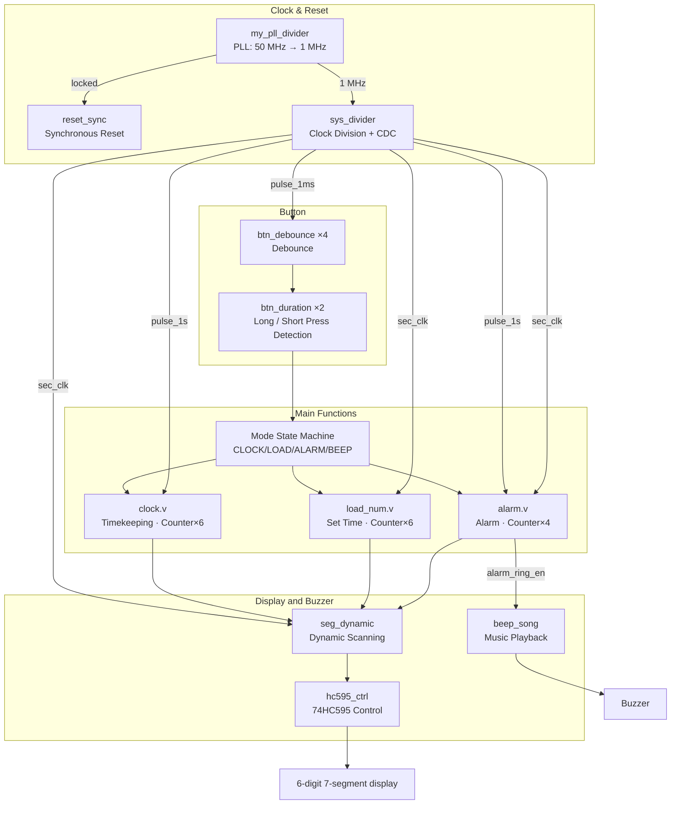

# FPGA-Based Multi-function Digital Clock

[简体中文](README.md)

> This project implements a multi-function digital clock on FPGA based on Verilog HDL. It displays the current time on a 6-digit 7-segment display and supports time-setting (load_num), alarm, and other interactive functions.

<!-- TODO: **考虑是否添加个人情况说明：本项目属于自学verilog后的阶段性检测，很多设计在实际工程中可能并不适用**-->

## Catalog
- [FPGA-Based Multi-function Digital Clock](#fpga-based-multi-function-digital-clock)
  - [Catalog](#catalog)
  - [Development Environment](#development-environment)
  - [Before You Start](#before-you-start)
    - [1. PLL - my\_pll\_divider (50 MHz → 1 MHz)](#1-pll---my_pll_divider-50-mhz--1-mhz)
    - [2. RAM - my\_ram (256 \* 12 bit read only music score)](#2-ram---my_ram-256--12-bit-read-only-music-score)
    - [3. Link music score file .mif](#3-link-music-score-file-mif)
    - [4. Others](#4-others)
  - [Main Functions](#main-functions)
  - [Features](#features)
  - [Design Overview](#design-overview)
  - [Key Mapping](#key-mapping)
  - [Notes](#notes)

## Development Environment

- EDA: Quartus II
- Hardware: Cyclone IV EP4CE10F17C8N on an EmbedFire Journey Pro development board
- On-board clock: 50 MHz crystal oscillator
- Peripherals: 6-digit 7-segment display (with decimal points) driven by the 74HC595, 4 buttons (choose / num_up / num_down / load), one reset button

## Before You Start

This project is **not a pure RTL project**: In `clock_mode.v` a PLL IP-core was instantiated as my_pll_divider and in `beep_song.v` a RAM IP-core was instantiated as my_ram. I do not commit the IP-core files to the repository because they are generated by the Quartus II MegaWizard and are tied to a specific device. So you need to configure them in your own EDA. 

**How to rebuild the two IP-cores:** Use the parameters below to generate the two IP-cores with your own EDA tool. Name them my_pll_divider / my_ram and ensure the port names in your IP-core file are the same as those in `clock_mode.v` (which instantiates the PLL) / `beep_song.v` (which instantiates the RAM). 

**For the settings I don't mention below, please keep them at their default values.**

### 1. PLL - my_pll_divider (50 MHz → 1 MHz)

| Setting | Value | Note |
| --- | --- | --- |
| IP type | ALTPLL | - |
| Currently selected device family | Cyclone IV E (EP4CE10F17C8N) | Choose your own chip's name |
| Frequency of the inclk0 input | 50 MHz (i.e. 20000 ps) | Choose your own chip's parameters |
| Output clock c0 | clock multiplication factor ×1, clock division factor ÷50 → **1 MHz** | Choose your own chip's parameters |
| c0 duty cycle | 50% | - |
| c0 clock phase shift | 0° | - |
| Compensate Clock | CLK0 | Choose your own chip's parameters |

The port names of the generated module (instantiated in `clock_mode.v`) are as follows: 

| Port | Direction | Connection | Explanation |
| --- | --- | --- | --- |
| `areset` | input | `1'b0` | Reset (active high). PLL is automatically reset only at power-on; it is not controlled by the system reset signal `rst_n`. |
| `inclk0` | input | `sys_clk` | 50 MHz crystal oscillator |
| `c0` | output | `sys_clk_1mhz` | 1 MHz output as pre_clk domain for the system |
| `locked` | output | `locked_sig` | The lock flag controls the release of the global reset; the system stays in reset while the PLL is not locked. |

### 2. RAM - my_ram (256 * 12 bit read only music score)

| Setting | Value | Note |
| --- | --- | --- |
| IP type | RAM: 1-PORT (ALTSYNCRAM) | - |
| Currently selected device family | Cyclone IV E (EP4CE10F17C8N) | Choose your own chip's name |
| Width of the output bus | 12 bit | - |
| Width of the address | 8 bit (depth 256 i.e. 256 words) | - |
| Operation Mode | Single-Port | - |
| Read-during-write behaviour | New Data; read-only in this project through tying wren to 1'b0 | Different IP-cores have different port names |
| Output register | Registered output on the rising edge of clock | - |

The port names of the generated module (instantiated in `beep_song.v`) are as follows: 

| Port | Direction | Connection | Explanation |
| --- | --- | --- | --- |
| `address[7:0]` | input | `rd_addr` | Music score address pointer |
| `clock` | input | `sys_clk` | System clock |
| `data[11:0]` | input | `12'd0` | Read-only; write port is unused |
| `wren` | input | `1'b0` | Read-only; write enable port disabled |
| `q[11:0]` | output | `rd_data` | Music score code read from RAM |

The format of music score code is shown below. It is decoded by `beep_song.v`. The code is 12 bits wide = `{octave[3:0], note name[3:0], duration[3:0]}`. 

| Field | Value |
| --- | --- |
| Octave | 3/4/5 = Oct3/4/5, 0 = rest, F = end marker |
| Note name | 1~7 = DO/RE/ME/FA/SO/LA/XI, 8~C = Sharp (DO♯/RE♯/FA♯ etc.), 0 = rest, F = end marker |
| Duration | 1 = sixteenth note, 2 = eighth note, 3 = dotted eighth note, 4 = quarter note, 6 = dotted quarter note, 8 = half note, F = whole note |

Note: 
- The end marker should be: bit[11:4]=`FF`, bit[3:0] are don't-care bits, but they must still be written. 
  - The end marker corresponds to the final barline `:||` in sheet music. As soon as the FPGA samples `FF` in the high 8 bits of the music score code, it stops reading and does not parse the low 4 bits. The low 4 bits may therefore hold anything, but they must not be left out. If only `FF` is written, the compiler treats it as the low 8 bits and zero-pads the high 4 bits, so the value actually stored is `0FF` i.e. bit[11:4] becomes `0F` instead of `FF` - and the end marker is no longer recognized. 

### 3. Link music score file .mif

The music score code is stored in `beep/`. There are two songs: 
- `your_new_home.mif` - _Your New Home_, the theme song of _The Amazing Digital Circus_. The default song. 
- `qifengle.mif` - _Qi Feng Le_

Select one of them as the memory content data file in the IP configuration wizard of your EDA. 
**Attention: init_file path is relative to the directory containing the main project `.qpf` file, not to the RAM file itself**. 

Change the song: 
1. Change the init_file path to another `.mif` 
2. Change the BPM parameter to the matching value in beep_song.v. ( _Qi Feng Le_ BPM is 80, _Your New Home_ is 90, a little bit faster ). After that, compile the whole project. If the RAM is not linked to a `.mif` (or the path is wrong), it will be empty. So the beep won't ring. 

### 4. Others

- The system clock is set as **50 MHz**: The tone and BPM in `beep_song.v`, the division parameters in `sys_divider.v` are designed according to 50 MHz. If your frequency of crystal oscillator (system clock) is not the same as mine, please change these parameters. 
- The files of the two IP-cores above belong to my chip. **Other chips cannot use them directly.** So I have not open-sourced them. Users need to rebuild them with their own EDA and rewrite the instantiation in `clock_mode.v` & `beep_song.v`. 
- The button pin assignments are shown in the Key Mapping table. The output pins of the 74HC595 chips (`hc595_ctrl.v`: `stcp` / `shcp` / `ds` / `oe`) and buzzer (`beep_song.v`: beep) should be assigned in accordance with your own development board. 

## Main Functions

- ✅Clock: Display the time including hour, minute and second. The decimal points blink at 1 Hz. 
- ✅Set Time (load_num): Short press load button to switch to this mode. The 7-segment display first shows `LOAd` for about 1 second as a prompt. And then, users can set the time in the edit page and long press load button to confirm the setting. If users don't press any button for 15 seconds, the system will switch back to clock automatically. 
	- Actually, the duration is not 15 seconds. Firstly, the prompt `LOAd` takes (0.5, 1] seconds. Secondly, the moment of counters' update, driven by pulse_1s, is offset from the moment when users press the button by [0, 1) seconds. As a result, the time in the edit page is 13~14.5 seconds, after which the mode will change back to clock. 
- ✅Alarm: 4 alarms (the number of alarms is a parameter and can be changed), each of which can be enabled or disabled. Users can set the hour and minute, while the seconds are fixed at 00.  
- ✅Alarm Ringing: After the alarm is triggered, the passive buzzer plays _Qi Feng Le_ or _Your New Home_. The song lasts for 59 seconds. If users want to stop, press choose, num_up or num_down. 
- ✅Ringing Display: If the current mode is clock, after the alarm is triggered, the 7-segment display switches to the ringing display, which shows the time of the ringing alarm and blinks slowly at 0.5 Hz. 

## Features

- **One module is instantiated in three modules**: `counter.v` is a universal counter. The radix (i.e. the maximum count value) is decided by the port `radix_data`. This module is instantiated in `clock.v` `load_num.v` `alarm.v` 16 times. Every digit connects with a counter, so the counter outputs are already in BCD, and no binary-to-BCD conversion is needed. 
- **Variable-radix**: Since every digit connects to its unique counter, its radix is independent. So this project faces the hour units digit variable-radix problem: when the hour tens digit is 0/1, the radix of hour units is decimal, but when the hour tens digit is 2, the radix of hour units is radix 4. Let me take the timekeeping & time-setting functions in `clock.v` module as an example: When displaying the time, the radix of hour units digit `radix_hour` is decided by the output of hour tens digit counter out_hour[7:4], while time-setting, the radix is decided by the hour tens digit data_hour[7:4] loaded to the clock. 
	- Similar handling is also used in `load_num.v` and `alarm.v` modules; this is the hardest part of the whole project. 
- **Clock Domain Crossing**: The PLL output 1 MHz clock (pre_clk domain) and system 50 MHz clock (sys_clk domain) are two clock domains in this project. I use the signals from the pre_clk domain to drive the always blocks in the sys_clk domain, which causes CDC violations. To avoid metastability, I use toggle-flag + three-stage synchronizer + edge detection. 
- **State Machine**: The state machines are widely used in this project, including three-stage state machines in `clock_mode.v` `btn_duration.v` and three state machines cooperating together in `load_num.v` `alarm.v`. 
- **Parameterized Width**: Some counter bit widths are computed with `$clog2`. The debounce time `DEBOUNCE_MS`, long & short press threshold `SHORT_END_MS` `LONG_PRESS_MS`, the binary input width `BIN_WIDTH` of binary-to-BCD module are all parameterized the same way. 

## Design Overview

## Key Mapping

> Mode names come from the state variables of state machines in the code: MODE_CLOCK / MODE_LOAD / MODE_ALARM are defined in clock_mode.v, while ALARM_VIEW / ALARM_EDIT are defined in alarm.v. A hyphen (-) joins two states that belong to different modules.

| Button | Function | Pin | Key |
|------|------|------|------|
| choose | MODE_LOAD mode: switch the setting field (hour → minute → second → hour)  MODE_ALARM mode - ALARM_VIEW mode: switch the alarm number  MODE_ALARM mode - ALARM_EDIT mode: switch the setting field (state → hour → minute → state)   Alarm editing entrance: long press three seconds   Alarm ringing: pressing this button interrupts the ringing | M2 | KEY1 |
| num_down | Number -1   Alarm ringing: pressing this button interrupts the ringing | M1 | KEY2 |
| num_up | Number +1   Alarm ringing: pressing this button interrupts the ringing | E15 | KEY3 |
| load | MODE_CLOCK mode: short press to enter load_num mode   MODE_LOAD mode: short press to enter alarm mode, long press 3 seconds to confirm the time-setting MODE_ALARM mode - ALARM_VIEW mode: short press back to clock mode  MODE_ALARM mode - ALARM_EDIT mode: short press to cancel, long press for three seconds to confirm the alarm number   Alarm ringing: pressing load button cannot interrupt the ringing. In the future, it could be used as a snooze function: pressing load button stops the ringing, while pressing other buttons snoozes the alarm for ten minutes. | E16 | KEY4 |
| reset | reset | M15 | RESET |

## Notes

- In all blink displays, the blink of number and point is opposite, i.e. when the numbers are lit the points are dark, when the points are lit the numbers are dark. 
- Parameter instruction: Some counter widths are computed automatically via $clog2(N). The parameter N should not be less than 2. 
- The hour bits Variable-radix design easily has some bugs. Pay attention to the time when the radix changes. Take the clock function as an example: When the hour is 20~23, edit the time-setting to 04~09 or 14~19. After confirming the time-setting, check whether the units digit of hour is wrongly clamped to 3 (i.e. the hour is 03 or 13). The check is similar in load_num. For alarm function, except checking the edge of time-setting, the switch from the default `--` display to normal counting should also be checked. 
  - It is hard to explain without codes. I wrote detailed notes in the codes of `clock.v` `load_num.v` `alarm.v`. 
- The signal alarm_ring_en generated from `alarm.v` stays high level for 1 second, which is received by `clock_mode.v` to trigger the counter_beep increment. Before counter_beep reaches 59, beep_en stays high and is fed to `beep_song.v` module. 
- The data flow for the beep display: `alarm.v` records the alarm number by beep_idx and pulls the alarm_ring_en to high level. Receiving the alarm_ring_en signal, `clock_mode.v` pulls alarm_beep_disp_en to high level, which `alarm.v` then detects. `alarm.v` outputs the time of the ringing alarm (whose index is beep_idx) on the disp_* ports to `clock_mode.v`. Finally, `seg_dynamic.v` receives those disp_* signals and displays the alarm time. 
- `btn_duration.v` module is in charge of deciding the long / short press of the button. If the duration of pressing is no more than 500 ms, it is a short press. If the duration of pressing reaches 3 s, it is a long press. If the duration is between the two thresholds, it is invalid. Since all buttons are debounced at first, the actual long / short press thresholds should each be extended by the 20 ms debounce time. 
