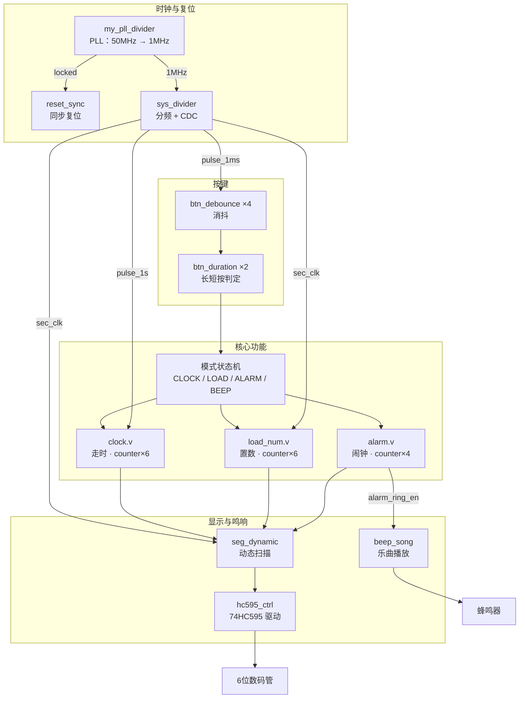

# 数显时钟的FPGA开发

[简体中文](README.md) | [English](README.en.md)

> 基于 Verilog 的 FPGA 数显时钟，支持走时、置数与闹钟功能。

## 目录
- [数显时钟的FPGA开发](#数显时钟的fpga开发)
  - [目录](#目录)
  - [开发环境](#开发环境)
  - [主要功能](#主要功能)
  - [项目特色](#项目特色)
  - [IP 核配置](#ip-核配置)
    - [软件架构](#软件架构)
  - [按键映射](#按键映射)
  - [备注](#备注)

## 开发环境
- 软件：Quartus II
- 器件：Cyclone IV EP4CE10F17C8N 野火征途Pro开发板
- 板载时钟：50MHz 晶振
- 外设：6位数码管（74HC595驱动）、4个独立按键（选择/上调/下调/加载）、1个复位键

## 主要功能
- ✅ 时钟模式：时分秒正常走时，小数点1Hz闪烁
- ✅ 置数模式：短按load键切换模式，可分别设置时/分/秒，长按确认，15秒无操作自动退出

    （由于LOAd显示占用时间，实际在编辑置数的界面是约14秒无操作自动退出）
- ✅ 闹钟模式：4组闹钟，支持使能/失能切换、分别设置时/分（秒固定为00）
- ✅ 闹钟鸣响：闹钟触发时播放乐曲《起风了》或《your new home》，响90秒后自动停止，按choose、num_up、num_down任意键可提前关闭
- ✅ 鸣响显示：闹钟触发时数码管自动切换到鸣响显示模式，以1Hz慢闪烁显示当前鸣响闹钟的时间

## 项目特色
- **一次编写，三处复用**：`counter.v` 是通用 BCD N 进制加减计数器，进制由参数 `radix_data` 指定，被 `clock.v`（走时）、`load_num.v`（手动置数）、`alarm.v`（闹钟编辑）三处共实例化 16 次，无需为每个数码管位单独写计数器。
- **变进制（动态进制）设计**：小时个位的进制不固定——十位为 0/1 时个位是十进制（0~9），十位为 2 时个位是四进制（0~3，对应 20~23 时）。进制由 `radix_hour` 动态计算：计数时跟随当前值，置数时跟随装载值，从根上规避"置数瞬间进制错乱"这一经典 bug。
- **跨时钟域（CDC）**：PLL 输出的 1MHz（pre_clk 域）与系统 50MHz（sys_clk 域）双时钟域之间，采用 toggle-flag + 三级同步寄存器 + XOR 边沿检测，兼顾抗亚稳态、脉宽精确、不漏脉冲。
- **三段式状态机**：顶层模式切换、置数交互、闹钟编辑等多处状态机均按"状态更新 / 状态切换 / 状态输出"三段式编写。
- **参数化位宽**：计数器位宽用 `$clog2` 自动计算；消抖时间与长短按阈值通过 `DEBOUNCE_MS`、`SHORT_END_MS`、`LONG_PRESS_MS` 参数调节，无需改动内部逻辑。

## IP 核配置

| IP 核 | 模块名 | 关键参数 |
|---|---|---|
| PLL | `my_pll_divider`（altpll） | 输入 50MHz → 输出 c0 = 1MHz（÷50，50% 占空比），`locked` 输出锁定标志 |
| RAM | `my_ram`（altsyncram，单端口） | 深度 256 × 12 位，只读（wren 恒 0），初始化文件 `your_new_home.mif` |

- PLL 的 `locked` 信号用于全局复位门控：PLL 未锁定时系统保持复位，锁定后才同步释放（配合 `reset_sync.v` 实现）。
- RAM 存储乐谱数据，每 12 位一个音符 `{八度[3:0], 音名[3:0], 时值[3:0]}`。初始化文件在 `rtl/beep/` 下，有两首可选：`qifengle.mif`（《起风了》）和 `your_new_home.mif`（《认清现实的小曲儿》/神奇数字马戏团主题曲）。切换时改 `my_ram.v` 里的 `init_file` 路径即可（该路径是相对主工程 `.qpf` 文件，而非相对 `my_ram.v`）。

### 软件架构

## 按键映射
| 按键 | 功能 | 引脚映射 | 实体按键 |
|------|------|------|------|
| choose | 置数模式：切换设置字段（时→分→秒→时） 闹钟浏览模式：切换闹钟编号（0~3循环） 闹钟编辑模式：切换设置字段（状态→时→分→状态） 闹钟编辑入口：长按3秒进入编辑  闹钟鸣响：按下可中断鸣响 | M2 | KEY1 |
| num_down | 当前字段数值 -1  闹钟鸣响：按下可中断鸣响 | M1 | KEY2 |
| num_up | 当前字段数值 +1  闹钟鸣响：按下可中断鸣响 | E15 | KEY3 |
| load | 时钟模式：短按进入置数模式 置数模式：短按进入闹钟模式，长按3秒确认置数 闹钟浏览模式：短按返回时钟模式 闹钟编辑模式：短按取消编辑，长按确认写入  闹钟鸣响：注意，按下load无法中断闹钟鸣响，以后另有用途 | E16 | KEY4 |
| reset | 系统复位 | M15 | RESET |

## 备注
- 小时进制动态显示很容易出bug，上板验证时尤其注意考察：前一时刻小时为20\~23，后一时刻，置数前小时为04\~09/14\~19的情况下，置数后是否会跳变为03/13

    说得比较抽象， load_num 代码中有详细解释。
- alarm_ring_en 维持1秒高电平后自动清除，输出到 clock_mode 里，触发 counter_beep 自增，计数未达到90前， beep_en 持续拉高，作为 beep_song 模块的输入
- 闹钟鸣响时，状态机自动从 MODE_CLOCK 切换到 MODE_BEEP，数码管显示当前鸣响闹钟的时间（以1Hz慢闪烁，1秒亮/1秒灭）
- 闹钟鸣响显示的数据流：alarm.v 在时间匹配时用 index_beep 记录触发闹钟编号，clock_mode 拉高 alarm_beep_disp_en 后，alarm.v 将对应闹钟时间以闪烁形式输出到 disp_* 端口，供 seg_dynamic 扫描显示
