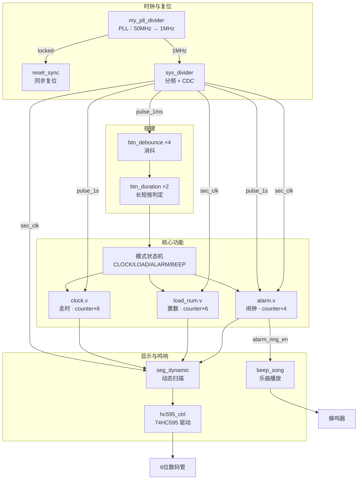

# 数显时钟的FPGA开发

[English](README.en.md)

> 基于 Verilog 的 FPGA 数显时钟，支持走时、置数与闹钟功能。

## 目录
- [数显时钟的FPGA开发](#数显时钟的fpga开发)
  - [目录](#目录)
  - [开发环境](#开发环境)
  - [使用注意事项](#使用注意事项)
    - [① PLL —— my\_pll\_divider（50MHz → 1MHz）](#-pll--my_pll_divider50mhz--1mhz)
    - [② RAM —— my\_ram（256 × 12bit 只读乐谱）](#-ram--my_ram256--12bit-只读乐谱)
    - [③ 关联 .mif 乐谱文件](#-关联-mif-乐谱文件)
    - [④ 其它提醒](#-其它提醒)
  - [主要功能](#主要功能)
  - [项目特色](#项目特色)
  - [软件架构](#软件架构)
  - [按键映射](#按键映射)
  - [备注](#备注)

## 开发环境

- 软件：Quartus II
- 器件：Cyclone IV EP4CE10F17C8N 野火征途Pro开发板
- 板载时钟：50MHz 晶振
- 外设：6位数码管（74HC595驱动）、4个独立按键（选择/上调/下调/加载）、1个复位键

## 使用注意事项

本项目**不是纯 RTL 工程**：`clock_mode.v` 实例化了 PLL 的 `my_pll_divider`，`beep_song.v` 实例化了 RAM 的 `my_ram`。仓库**不包含**这两个 IP 的生成文件（它们是 Quartus 向导生成的、与器件绑定，不同环境需自行配置），所以拿到源码后**不能直接编译**——第一次会报 `module my_pll_divider / my_ram not found`。

**最小复现路径**：在 EDA 工具里按下列参数重建这两个 IP，并把模块命名为 `my_pll_divider` / `my_ram`、端口名保持一致，即可编译。若想用其它模块名/端口名，则需同步修改 `clock_mode.v`（PLL 例化处）与 `beep_song.v`（RAM 例化处）。

**提及的配置保持默认即可**

### ① PLL —— my_pll_divider（50MHz → 1MHz）

| 配置项 | 值 | 备注 |
|---|---|---|
| IP 类型 | ALTPLL | 无 |
| 目标器件 | Cyclone IV E（EP4CE10F17C8N） | 请根据您的芯片选择型号 |
| 输入频率 inclk0 | 50 MHz（即 20000 ps） | 请根据您的芯片选择参数 |
| 输出 c0 | 倍频 ×1，分频 ÷50 → **1 MHz** | 请根据您的芯片选择参数 |
| c0 占空比 | 50% | 无 |
| c0 相位偏移 | 0° | 无 |
| 补偿时钟 | CLK0 | 请根据您的芯片选择参数 |

生成模块的端口（在顶层 `clock_mode.v` 中实例化）：

| 端口 | 方向 | 顶层连接 | 说明 |
|---|---|---|---|
| `areset` | input | 恒接 `1'b0` | 复位（高有效）；PLL 仅上电自动复位，不受系统复位 rst_n 的控制 |
| `inclk0` | input | `sys_clk` | 50MHz 晶振输入 |
| `c0` | output | `sys_clk_1mhz` | 1MHz 输出，作为全系统的 pre_clk 域 |
| `locked` | output | `locked_sig` | 锁定标志，控制全局复位释放（PLL 未锁定时系统保持复位） |

### ② RAM —— my_ram（256 × 12bit 只读乐谱）

| 配置项 | 值 | 备注 |
|---|---|---|
| IP 类型 | RAM: 1-PORT（ALTSYNCRAM） | 无 |
| 目标器件 | Cyclone IV E（EP4CE10F17C8N） | 请根据您的芯片选择型号 |
| 数据位宽 | 12 bit | 无 |
| 地址位宽 | 8 bit（深度 256） | 无 |
| 操作模式 | Single-Port（单端口） | 无 |
| 读/写模式 | 读优先；本项目只读（wren 恒 0） | 不同IP核有不同的端口(wren)命名 |
| 输出寄存 | 由 clock 上升沿寄存输出 | 无 |

生成模块的端口（在 `beep_song.v` 中实例化）：

| 端口 | 方向 | 顶层连接 | 说明 |
|---|---|---|---|
| `address[7:0]` | input | `rd_addr` | 乐谱地址指针 |
| `clock` | input | `sys_clk` | 系统时钟 |
| `data[11:0]` | input | 恒接 `12'd0` | 只读，写数据口闲置 |
| `wren` | input | 恒接 `1'b0` | 只读，写使能无效 |
| `q[11:0]` | output | `rd_data` | 读出的乐谱编码 |

乐谱编码格式（由 `beep_song.v` 解析，每 12 位 = `{八度[3:0], 音名[3:0], 时值[3:0]}`）：

| 字段 | 取值 |
|---|---|
| 八度 | 3/4/5 = Oct3/4/5，0 = 休止，F = 结束标记 |
| 音名 | 1\~7 = DO/RE/ME/FA/SO/LA/XI，8\~C = 升半音（DO♯/RE♯/FA♯ 等），0 = 休止，F = 结束标记|
| 时值 | 1 = 十六分，2 = 八分，3 = 附点八分，4 = 四分，6 = 附点四分，8 = 二分，F = 一分 |

注：
- 结束标记的 bit[11:4] = FF, bit[3:0] 可任意填写
  - 结束标记相当于乐谱中的终止线 :||，FPGA 一旦识别到高 8 位为 FF 即立即停止读取，不再解析剩余的低 4 位，因此低 4 位可任意填写，但不能不写，否则高 8 位的 FF 在综合时会被识别为低 8 位，高 4 位会补零，从而导致错误。

### ③ 关联 .mif 乐谱文件

乐谱数据在仓库 `beep/` 下，两首可选：
- `your_new_home.mif` —— _Your New Home_（神奇数字马戏团主题曲，又称认清现实的小曲儿），**当前默认加载**
- `qifengle.mif` —— 《起风了》

在 RAM 的 MegaWizard 配置页将初始化文件指向其中之一。
**注意：`init_file` 路径是相对主工程 `.qpf` 文件所在目录的，不是相对 RAM 文件本身**

换歌：
1. 改 `init_file` 指向另一份 `.mif` 
2. beep_song.v 中的 BPM 参数需改为对那个歌曲的数值（起风了=80，_Your New Home_=90，稍快一点）。然后重新全编译即可。RAM 未关联 `.mif`（或路径错误）时内容为空，蜂鸣器不会响。

### ④ 其它提醒

- 系统时钟假定 **50 MHz**：`beep_song.v` 的音高/节拍参数（`CLK = 50_000_000`、BPM）与 `sys_divider` 的分频常数均按此设计，换时钟频率需同步调整。
- 以上两个 IP 是 我的芯片。**其他芯片无法直接使用**，所以未将 Quartus II 生成的 IP-core 配置代码开源。您需使用您的 EDA 工具自带的 PLL/BRAM 原语替代，并改写 `clock_mode.v` 与 `beep_song.v` 中的实例化
- 按键引脚绑定见下方「按键映射」表；数码管扫描输出（74HC595：`stcp` / `shcp` / `ds` / `oe`）与蜂鸣器（`beep`）引脚请按你的开发板自行分配。

## 主要功能

- ✅ 时钟模式：时分秒正常走时，小数点1Hz闪烁
- ✅ 置数模式：短按load键切换到此模式，先显示约 1 秒 `LOAd` 提示。然后用户可分别设置时/分/秒，长按确认，15秒无操作自动退出
    - `LOAd` 显示占用 (0.5,1] 秒，计数驱动秒脉冲 pulse_1s, 相对于用户按下load键进入 load_num 模式的时刻，有 [0,1) 秒的相位差。这两个因素导致实际在编辑置数的界面计算的是长是 13~14.5 秒
- ✅ 闹钟模式：4组闹钟（可增加/减少个数），支持使能/失能切换、分别设置时/分（秒固定为00）
- ✅ 闹钟鸣响：闹钟触发时播放乐曲《起风了》或 _Your New Home_ ， 59 秒后自动停止，按choose、num_up、num_down任意键可提前关闭
- ✅ 鸣响显示：如果当前模式处于 clock ，闹钟触发时，数码管自动切换到鸣响显示模式，以0.5Hz慢闪烁显示当前鸣响闹钟的时间

## 项目特色

- **一次编写，三处复用**：`counter.v` 是通用 BCD N 进制加减计数器，进制由参数 `radix_data` 指定，被 `clock.v`（走时）、`load_num.v`（手动置数）、`alarm.v`（闹钟编辑）三处共实例化 16 次，每一个数位对应一个counter，所以不必进行二进制到 BCD 编码的转换。
- **变进制（动态进制）设计**：由于每一个数位都对应一个 counter, 每一位的进制都是独立的，因此会面临小时个位变进制的问题：小时十位为 0/1 时，个位是十进制（0\~9），十位为 2 时，个位是四进制（0\~3，对应 20\~23 时）。具体解决方案以 `clock.v` 模块的走时和置数功能为例，正常走时的时候，小时个位的进制 `radix_hour` 由当前小时十位 counter 的输出 out_hour[7:4] 决定，置数时，进制由装载的小时十位 data_hour[7:4] 决定。
  - 在 `load_num.v` 和 `alarm.v` 中也有类似处理，是整个项目中最难解决的问题。
- **跨时钟域（CDC）**：PLL 输出的 1MHz（pre_clk 域）与系统 50MHz（sys_clk 域）双时钟域之间，采用 toggle-flag + 三级同步寄存器 + 边沿检测，解决亚稳态问题。
- **状态机**：广泛采用状态机，顶层模式切换、按键长短按判定均使用三段式状态机，置数、闹钟使用三个状态机协同工作。
- **参数化位宽**：计数器位宽用 `$clog2` 自动计算；消抖时间 `DEBOUNCE_MS`，长短按阈值 `SHORT_END_MS` `LONG_PRESS_MS`，二进制转BCD的二进制位宽 `BIN_WIDTH`，都采用了这种设计。

## 软件架构

## 按键映射

| 按键 | 功能 | 引脚映射 | 实体按键 |
|------|------|------|------|
| choose | 置数模式：切换设置字段（时→分→秒→时） 闹钟浏览模式：切换闹钟编号 闹钟编辑模式：切换设置字段（状态→时→分→状态） 闹钟编辑入口：长按3秒进入编辑  闹钟鸣响：按下可中断鸣响 | M2 | KEY1 |
| num_down | 当前字段数值 -1  闹钟鸣响：按下可中断鸣响 | M1 | KEY2 |
| num_up | 当前字段数值 +1  闹钟鸣响：按下可中断鸣响 | E15 | KEY3 |
| load | 时钟模式：短按进入置数模式 置数模式：短按进入闹钟模式，长按3秒确认置数 闹钟浏览模式：短按返回时钟模式 闹钟编辑模式：短按取消编辑，长按3秒确认写入  闹钟鸣响：注意，按下load无法中断闹钟鸣响，可能以后会开发“10分钟再响”功能，届时可能这么设计——按下load真正停止闹钟，按下其余按键触发再响 | E16 | KEY4 |
| reset | 系统复位 | M15 | RESET |

## 备注

- 所有数字闪烁的显示中，小数点与数字是反向闪烁的，即数字亮的时候小数点灭，小数点亮的时候数字灭
- 参数取值说明： 本项目使用 \$clog2 自动计算部分计数器的位宽。对于直接采用 \$clog2(N) 定宽的计数器，相关参数应不小于 2。~~修改默认参数时，还需确认计数器的实际最大值是否超出其位宽能够表示的范围，尤其应注意计数阈值为 2 的整数次幂的情况。~~
- 小时进制动态显示很容易出bug，上板验证时尤其注意考察进制转换时刻：以时钟功能为例，当前 clock 为20\~23，置数时间编辑为04\~09/14\~19，确认置数后, clock 是否会跳变为03/13；置数功能的检查类似；闹钟功能的检查，不仅要检查置数的这些边界情况，还要检查从默认的 -- 切换到正常计数时的边界情况
  - 说得比较抽象, `clock.v` `load_num.v` `alarm.v` 代码中有详细解释。
- alarm_ring_en 维持1秒高电平后自动清除，输出到 `clock_mode.v` 里，触发 counter_beep 自增，计数未达到 59 前， beep_en 持续拉高，作为 `beep_song.v` 模块的输入
- 闹钟鸣响显示的数据流：`alarm.v` 在时间匹配时用 beep_idx 记录触发闹钟编号，`clock_mode.v` 拉高 alarm_beep_disp_en 后，`alarm.v` 将编号为 beep_idx 的闹钟的时间以闪烁形式输出到 disp_* 端口，在`clock_mode.v`供    `seg_dynamic.v` 扫描显示
- `btn_duration.v` 负责管理按键长短按判定，按下时长小于 500ms 判定位短按，时长长于 3s 判定为长按，大于 500ms 小于 3s 判定为无效。由于对按键的处理是 btn_debounce 与 btn_duration 串联，所以实际长短按判定边界都应加上 20ms 消抖时间
