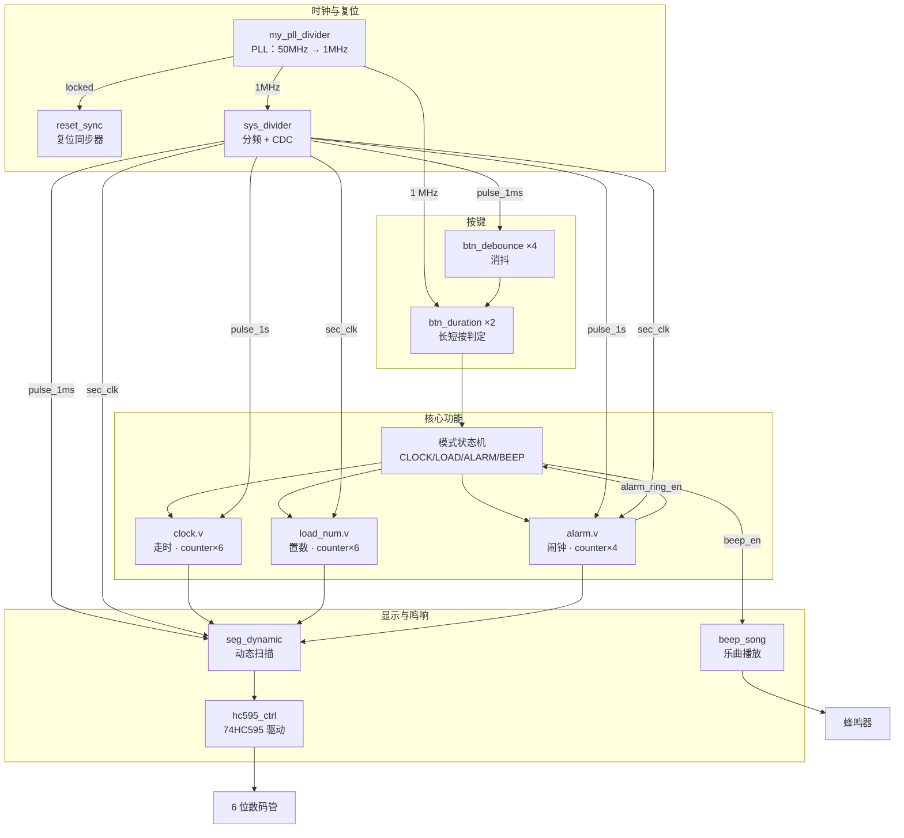

# 数显时钟的FPGA开发

**简体中文** · [English](README.en.md)

> 基于 Verilog 的 FPGA 数显时钟，支持走时、置数与闹钟功能。
> 
> 本项目是我自学 Verilog 的阶段性作品，很多设计在实际工程里未必适用，[点击这里查看完整开发历程](HISTORY.md)。

## 目录
- [数显时钟的FPGA开发](#数显时钟的fpga开发)
  - [目录](#目录)
  - [开发环境](#开发环境)
  - [使用注意事项](#使用注意事项)
    - [① PLL —— my\_pll\_divider（50MHz → 1MHz）](#-pll--my_pll_divider50mhz--1mhz)
    - [② RAM —— my\_ram（256 × 12bit 只读乐谱）](#-ram--my_ram256--12bit-只读乐谱)
    - [③ 关联 .mif 乐谱文件](#-关联-mif-乐谱文件)
    - [④ 其它提醒](#-其它提醒)
  - [主要功能](#主要功能)
  - [项目特色](#项目特色)
  - [软件架构](#软件架构)
  - [按键映射](#按键映射)
  - [备注](#备注)
  - [致谢](#致谢)
  - [许可证](#许可证)

## 开发环境

- 软件：Quartus II 13.0
- 器件：Cyclone IV EP4CE10F17C8N 野火征途 Pro 开发板
- 板载时钟：50MHz 晶振
- 外设：6 位数码管（由两片级联的 74HC595 驱动，14 位 = 8 位段选 + 6 位位选）、4 个独立按键（`choose` / `num_up` / `num_down` / `load`）、1 个复位键

## 使用注意事项

本项目**不是纯 RTL 工程**：`clock_mode.v` 实例化了 PLL 的 `my_pll_divider.v`，`beep_song.v` 实例化了 RAM 的 `my_ram.v`。仓库**不包含**这两个 IP 的生成文件（它们是 Quartus 向导生成的、与器件绑定，不同环境需自行配置），所以拿到源码后**不能直接编译**。

**最小复现路径**：在 EDA 工具里按下列参数重建这两个 IP，并把模块命名为 `my_pll_divider` / `my_ram`、端口名保持一致，即可编译。若想用其它模块名/端口名，则需同步修改 `clock_mode.v`（PLL 例化处）与 `beep_song.v`（RAM 例化处）。

**未在下表中列出的设置项，保持默认即可**

### ① PLL —— my_pll_divider（50MHz → 1MHz）

| 配置项 | 值 | 备注 |
|---|---|---|
| IP 类型 | ALTPLL | 无 |
| 输入频率 `inclk0` | 50 MHz（即 20000 ps） | 请选择您芯片的晶振频率 |
| 补偿时钟 | c0 | 保持默认 |
| 输出 c0 | 倍频 ×1，分频 ÷50 → **1 MHz** | 请根据您的芯片选择分频系数，使 PLL 输出 1MHz 频率 |
| c0 占空比 | 50% | 无 |
| c0 相位偏移 | 0° | 无 |

生成模块的端口（在顶层 `clock_mode.v` 中实例化）：

| 端口 | 方向 | 顶层连接 | 说明 |
|---|---|---|---|
| `areset` | input | 恒接 `1'b0` | 复位（高有效）；PLL 仅上电自动复位，不受系统复位 `rst_n` 的控制。`rst_n` 在锁相环锁定前一直为低，若用它驱动 `areset`，PLL 将永远无法脱离复位。 |
| `inclk0` | input | `sys_clk` | 50MHz 晶振输入 |
| `c0` | output | `sys_clk_1mhz` | 1MHz 输出，作为全系统的 `pre_clk` 域 |
| `locked` | output | `locked_sig` | 锁定标志，控制全局复位释放（PLL 未锁定时系统保持复位） |

### ② RAM —— my_ram（256 × 12bit 只读乐谱）

| 配置项 | 值 |
|---|---|
| IP 类型 | RAM: 1-PORT（单端口） |
| 数据位宽 | 12 bit |
| 存储字数 | 256（地址位宽 8 bit） |
| 读写同一地址时的输出 | New Data（输出新写入的数据）；本项目只读（`wren` 恒 0） |
| 输出寄存 | 使能（读出数据由 RAM 时钟寄存） |

生成模块的端口（在 `beep_song.v` 中实例化）：

| 端口 | 方向 | 顶层连接 | 说明 |
|---|---|---|---|
| `address[7:0]` | input | `rd_addr` | 乐谱地址指针 |
| `clock` | input | `sys_clk` | 系统时钟 |
| `data[11:0]` | input | 恒接 `12'd0` | 只读，写数据口闲置 |
| `wren` | input | 恒接 `1'b0` | 只读，写使能无效（不同 IP 核中写使能端口（`wren`）的名字不一样） |
| `q[11:0]` | output | `rd_data` | 读出的乐谱编码 |

乐谱编码格式（由 `beep_song.v` 解析，编码为 12 位 = `{八度[3:0], 音名[3:0], 时值[3:0]}`）：

| 字段 | 取值 |
|---|---|
| 八度 | 3 / 4 / 5 = Oct 3 / 4 / 5（Oct 4 从中央 C 开始，Do4 ≈ 262 Hz），0 = 休止，F = 结束标记 |
| 音名 | 1\~7 = DO / RE / MI / FA / SO / LA / XI，8\~C = DO♯ / RE♯ / FA♯ / SO♯ / LA♯（升半音），0 = 休止，F = 结束标记 |
| 时值 | 1 = 十六分，2 = 八分，3 = 附点八分，4 = 四分，6 = 附点四分，8 = 二分，F = 一分 |

注：
- 结束标记的 bit[11:4] = FF；bit[3:0] 可任意填写，但不能省略
  - 它相当于乐谱中的从头反复记号 `D.C.`，FPGA 一旦识别到高 8 位为 `FF`，就不再解析剩余的低 4 位，并把读指针归零、乐曲从头重播。但是低 4 位不能不写：如果只写 `FF` 两位，EDA 会把它当成低 8 位，在高 4 位补 0，实际得到的是 `0FF`，bit[11:4] 变成 `0F` 而不是 `FF`，结束标记就失效了。

### ③ 关联 .mif 乐谱文件

乐谱数据在 `beep/` 下，两首可选：
- `your_new_home.mif` —— _Your New Home_（神奇数字马戏团主题曲，又称认清现实的小曲儿），**当前默认加载**
- `qifengle.mif` —— 《起风了》

在 EDA 工具的 IP 核配置向导中，把存储器内容指向其中之一。
**注意：`init_file` 路径是相对主工程 `.qpf` 文件所在目录的，不是相对 RAM 文件本身**

换歌：
1. 改 `init_file` 指向另一份 `.mif` 
2. 把 `beep_song.v` 中的 `BPM` 参数改成该曲目对应的数值（《起风了》为 80，_Your New Home_ 为 90，节奏比前者稍快）。改完重新全编译即可。
3. 注：RAM 未关联 `.mif`（或路径错误）时内容为空，蜂鸣器不会响。

### ④ 其它提醒

- 系统时钟假定 **50 MHz**：如果您的晶振时钟频率不同，请调整 PLL 的分频系数，确保其输出信号频率仍为 1MHz。同步更新 `beep_song.v` 的 `CLK` 参数、音高常数（音符周期常量），检查 `hc595_ctrl.v` 的 `shcp` 时钟（12.5MHz，`sys_clk` 的四分频）是否还在 74HC595 的最大移位时钟频率之内
- 以上两个 IP 核配置文件与我的芯片绑定，**其他芯片无法直接使用**，因此没有把 Quartus II 生成的 IP 核配置代码开源。您需使用您的 EDA 工具重建，并改写 `clock_mode.v` 与 `beep_song.v` 中的实例化
- 按键引脚绑定见下方「按键映射」表；系统时钟 `sys_clk`，数码管扫描输出（74HC595：`stcp`, `shcp`, `ds`, `oe`）与蜂鸣器（`beep`）引脚请按您的开发板自行分配

## 主要功能

- ✅ 时钟模式：时分秒正常走时，小数点 1Hz 闪烁
- ✅ 置数模式：短按 `load` 键切换到此模式，先显示约 1 秒 `LOAd` 提示。然后用户可分别设置时/分/秒，长按确认，15 秒无操作自动取消置数并返回时钟模式
    - `LOAd` 显示占用 (0.5, 1] 秒；另外，置数界面的倒计时以 `pulse_1s` 为计数使能，而 `pulse_1s` 与用户按下 `load` 键（进入 `load_num` 模式）的时刻没有固定关系，二者存在 [0, 1) 秒的时间差。把两个因素算进去，用户在数字编辑界面实际能停留的时长是 13~14.5 秒
- ✅ 闹钟模式：默认 4 个闹钟（可通过 `clock_mode.v` 中的 `ALARM_CNT` 修改个数，最多可设置 10 个），支持使能/失能切换、分别设置时/分（秒固定为 00）。注：闹钟编号从 0 开始。
- ✅ 闹钟鸣响：闹钟触发时循环播放 `.mif` 中关联的乐曲（《起风了》或 _Your New Home_，目前选择的是后者），59 秒后自动停止，按 `choose` / `num_up` / `num_down` 任意键可提前关闭
- ✅ 鸣响显示：如果当前模式处于时钟模式，闹钟触发时，数码管自动切换到鸣响显示模式，以 0.5Hz 慢闪烁显示当前鸣响闹钟的时间

## 项目特色

- **一次编写，三处复用**：`counter.v` 是通用 BCD N 进制加减计数器，进制（计数上限）由端口 `radix_data` 指定，被 `clock.v`（走时）、`load_num.v`（手动置数）、`alarm.v`（闹钟编辑）三处共实例化 16 次，每一个数位各由一个 counter 负责，计数结果天然就是 BCD 编码，因此不必进行二进制到 BCD 编码的转换。
- **变进制（动态进制）设计**：由于每一个数位都对应一个 counter，每一位的进制都是独立的，因此会面临小时个位变进制的问题：小时十位为 0/1 时，个位是十进制（0\~9），十位为 2 时，个位是四进制（0\~3，对应 20\~23 时）。具体解决方案以 `clock.v` 模块的走时和置数功能为例，正常走时的时候，小时个位的进制 `radix_hour` 由当前小时十位 counter 的输出 `out_hour[7:4]` 决定，置数时，进制由装载的小时十位 `data_hour[7:4]` 决定。
	- `load_num.v` 和 `alarm.v` 中也有类似处理，这是整个项目中最棘手的地方。
- **跨时钟域（CDC）**：PLL 输出的 1MHz（`pre_clk` 域）与系统 50MHz（`sys_clk` 域）双时钟域之间，采用 toggle-flag + 两级同步器 + 一级延迟用于边沿检测，解决亚稳态问题。
- **状态机**：广泛采用状态机，顶层模式切换、按键长短按判定均使用三段式状态机，置数、闹钟使用三个状态机协同工作。
- **参数化位宽**：计数器位宽用 `$clog2` 自动计算；消抖时间 `DEBOUNCE_MS`、长短按阈值 `SHORT_END_MS` `LONG_PRESS_MS` 也都采用了参数化位宽设计。

## 软件架构

## 按键映射

| 按键 | 功能 | 引脚映射 | 实体按键 |
|------|------|------|------|
| choose | 置数模式：切换设置字段（时→分→秒→时） 闹钟模式-闹钟浏览模式：切换闹钟编号；长按 3 秒进入编辑 闹钟模式-闹钟编辑模式：切换设置字段（状态→时→分→状态） 闹钟鸣响：按下可中断鸣响 | M2 | KEY1 |
| num_down | 当前字段数值 -1  闹钟鸣响：按下可中断鸣响 | M1 | KEY2 |
| num_up | 当前字段数值 +1  闹钟鸣响：按下可中断鸣响 | E15 | KEY3 |
| load | 时钟模式：短按进入置数模式 置数模式：短按进入闹钟模式，长按 3 秒确认置数 闹钟模式-闹钟浏览模式：短按返回时钟模式 闹钟模式-闹钟编辑模式：短按取消编辑，长按 3 秒确认写入  闹钟鸣响：按下 load 无法中断闹钟鸣响。以后如果开发“10 分钟再响”功能，可能会改成：按下 load 彻底停止闹钟，按下其余按键则延后 10 分钟再响 | E16 | KEY4 |
| reset | 系统复位 | M15 | RESET |

## 备注

- 所有数字闪烁的显示中，小数点与数字是反向闪烁的，即数字亮的时候小数点灭，小数点亮的时候数字灭
- 参数取值说明：本项目使用 `$clog2` 自动计算部分计数器的位宽。对于直接采用 `$clog2(N)` 定宽的计数器，参数 N 应不小于 2：因为 `$clog2(1)` = 0 所以位宽 `[$clog2(N)-1:0]` = [-1:0]，这是 2 位宽而不是期望的 1 位宽
- 小时进制动态显示很容易出 bug，上板验证时要重点盯住进制转换的时刻。以时钟功能为例：当前时间是 20\~23 时，把置数界面的小时设成 04\~09 / 14\~19，确认置数后，检查小时个位是否被错误地钳位到 3（即小时显示为 03 / 13）。置数功能按同样方式检查。闹钟功能除了要检查这些置数边界，还要额外检查从默认的 -- 切换到正常计数时的那个时刻
  - 说得比较抽象，`clock.v` `load_num.v` `alarm.v` 代码中有详细解释。
- `alarm.v` 把 `alarm_ring_en` 拉高并保持 1 秒后自动拉低。`clock_mode.v` 读到高电平后让 `counter_beep` 自增；在 `counter_beep` 计到 59 前，`beep_en` 一直保持高电平，作为 `beep_song.v` 模块的输入
- 闹钟鸣响显示的数据流：`alarm.v` 在时间匹配时把触发闹钟的编号记进 `beep_idx`；`clock_mode.v` 拉高 `alarm_beep_disp_en` 后，`alarm.v` 将编号为 `beep_idx` 的闹钟时间以闪烁形式送到 `disp_*` 端口，再由`clock_mode.v` 转给 `seg_dynamic.v` 扫描显示
- `btn_duration.v` 负责管理按键长短按判定，按下时长不超过 500ms 判定为短按，达到 3s 判定为长按，介于两者之间判定为无效。由于按键信号先经 `btn_debounce.v` 消抖，再送入 `btn_duration.v` 判定，所以实际长按判定在 3s 的基础上叠加 20ms 消抖时间，而短按阈值不受影响，因为消抖模块对按下、抬起都进行消抖

## 致谢

- 感谢野火（EmbedFire）的 FPGA 教程和例程。
- 感谢学校老师们的教导。
- 感谢家人给予的支持。
- 感谢 DeepSeek 等 AI 工具在代码审查、文件头功能注释撰写、说明文档撰写中提供的建议与帮助。

## 许可证

本项目采用 [MIT 许可证](LICENSE)。`beep/` 下的 `.mif` 乐谱文件是对第三方歌曲的转写，仅供学习使用，版权归原权利人所有，不适用上述许可证。`hc595_ctrl.v`、`seg_dynamic.v` 改编自野火（EmbedFire）的教程代码，原始代码未声明许可证，其原有部分的版权归野火所有，不适用上述许可证。
